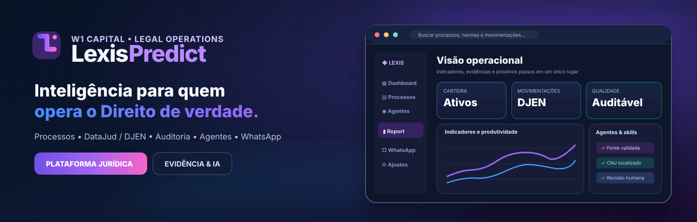
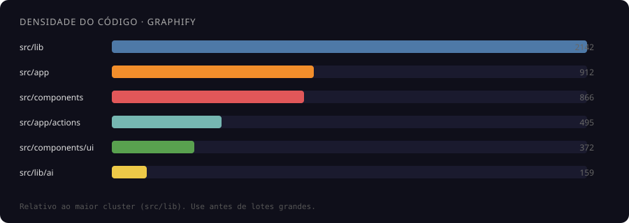

<div align="center">



### ⚖️ Inteligência para quem opera o Direito de verdade.

**Processos, evidências, atendimento, relatórios e agentes — uma plataforma para transformar trabalho jurídico em operações rastreáveis.**

<p>
  <a href="https://lexispredict.vercel.app"></a>
  <a href="docs/WHATSAPP-WEB-NAVEGADOR.md"></a>
  <a href="docs/IA-SEGURA-VERCEL-SUPABASE.md"></a>
  <a href="skills/lexis-ai-suite/SKILL.md"></a>
</p>

<p>


</p>

**[Plataforma](https://lexispredict.vercel.app)** ·
**[Superagente](https://lexispredict.vercel.app/chat)** ·
**[WhatsApp](https://lexispredict.vercel.app/whatsapp)** ·
**[Relatórios](https://lexispredict.vercel.app/report)** ·
**[Documentação](docs/)** ·
**[Mapa arquitetural](https://w1capital.github.io/LexisPredict/)**

</div>

---

## ✨ Conheça a plataforma

| 🏛️ **Carteira processual** | 🧠 **Inteligência com evidências** | 💬 **Atendimento multicanal** |
| :--- | :--- | :--- |
| CNJ, DataJud, DJEN, prazos, responsáveis e movimentações | Agentes especializados, fontes verificáveis, memória operacional e revisão humana | WhatsApp Web do operador ou WA.Auto conectado; envio e entrega não são presumidos |
| **📊 Report premium** | **🛡️ Segurança por empresa** | **⚙️ Modelo local sem travar o PC** |
| Produtividade, auditorias, histórico e exportação PDF | Sessão, perfis, visibilidade, Supabase e trilhas de auditoria | Scripts como alternativa leve; Qwen browser opt-in e GPU-only; modelos de servidor quando configurados |

> **Filosofia:** primeiro os fatos, depois as inferências. O LexisPredict não transforma falta de retorno em andamento inventado, nem interpreta ausência de consulta como prova de encerramento.

## 🧭 Arquitetura: onde cada parte realmente roda

<pre>
Operador (Chrome, Edge ou ego-lite)
    │  Next.js UI • WhatsApp Web • motor de regras
    ▼
Vercel (app + APIs + Server Actions)
    ├── Supabase (processos, equipes, evidências, auditoria e permissões)
    ├── DataJud / DJEN (consultas oficiais, quando disponíveis)
    ├── WA.Auto / worker no Render (opcional, conectado com QR)
    └── Motor de IA remoto / Colibri (opcional, com infraestrutura própria)

Qwen 0.5B no browser = usa RAM/GPU do operador, NÃO da Vercel ou Supabase.
</pre>

### 🎯 O que mudou nos agentes

- **Pesquisa legislativa:** acervo público [ctresb/leis](https://github.com/ctresb/leis), buscando norma/artigo sob demanda, com fonte e verificação de metadados. Texto convertido não dispensa consulta oficial.
- **WhatsApp Web:** modo de atendimento com rascunho aberto no navegador autenticado do operador, sem depender do WA.Auto e sem inventar confirmação de entrega.
- **Proteção de PCs com pouca memória:** nenhuma tentativa automática de Qwen 0,5B após falha dos motores online; GPU e aceite explícito são necessários para uso experimental.
- **Agentes especializados:** pesquisa, auditoria, atendimento, dossiês e conferência de fontes em vez de respostas genéricas sem evidência.

**Documentação focada:** [WhatsApp no navegador](docs/WHATSAPP-WEB-NAVEGADOR.md) · [Inferência segura](docs/IA-SEGURA-VERCEL-SUPABASE.md) · [Legislação](skills/legislacao-brasileira/SKILL.md) · [Skills de atendimento](skills/whatsapp-browser/SKILL.md) · [Fluxo de agentes](skills/lexis-ai-suite/SKILL.md)

## 🚀 Executar localmente para desenvolvimento


~~~bash
corepack enable
pnpm install --frozen-lockfile
pnpm dev       # http://localhost:9002
pnpm typecheck
pnpm test
pnpm build
~~~

O projeto utiliza **Node.js 24 LTS**. Configurações e credenciais de Supabase, provedores de IA e workers permanecem privadas; nunca publique chaves `service_role` ou tokens de WhatsApp no frontend. Executar Next.js localmente não desloca as funções de banco para o navegador.

---

## Mapa graphify ao vivo

<p align="center">
  <a href="https://w1capital.github.io/LexisPredict/">
    
  </a>
</p>

<p align="center">
  <a href="https://w1capital.github.io/LexisPredict/"><strong>⟶ Abrir mapa interativo (4.378 nós · 13.547 arestas · 225 comunidades)</strong></a>
</p>

| Métrica | Valor |
| ------- | ----- |
| **Nós** | 4.378 |
| **Arestas** | 13.547 |
| **Comunidades** | 225 |
| **Arquivo** | `docs/assets/graph.html` |
| **URL ao vivo** | [w1capital.github.io/LexisPredict](https://w1capital.github.io/LexisPredict/) |

### Densidade (onde mexer com cuidado)

| Pasta | ~símbolos | Papel |
| ----- | --------- | ----- |
| `src/lib` | **2.142** | Núcleo de domínio |
| `src/app` | **912** | Rotas Next |
| `src/components` | **866** | UI |
| `src/app/actions` | **495** | Server actions |
| `src/components/ui` | **372** | Design system |
| `src/lib/ai` | **159** | IA / motores |
| `src/lib/data-provider` | **58** | Provider / sync |
| `src/lib/hybrid` | **34** | Hybrid / Sheets (Plano B) |

### Paleta (mesmo visual do grafo)

| | Hex | Leitura |
|--|-----|---------|
| 🔵 | `#4E79A7` | Núcleo / lib |
| 🟠 | `#F28E2B` | App / rotas |
| 🔴 | `#E15759` | Componentes |
| 🩵 | `#76B7B2` | Actions |
| 🟢 | `#59A14F` | UI kit |
| 🟡 | `#EDC948` | IA |
| 🟣 | `#B07AA1` | Data provider |
| 🌸 | `#FF9DA7` | Hybrid |

### Ativar o mapa ao vivo (uma vez)

1. Coloque o HTML do graphify em **`docs/assets/graph.html`**
2. Repo → **Settings → Pages → Source: GitHub Actions**
3. Push do workflow `pages-docs.yml` (já no pacote) + pasta `docs/`
4. URL: `https://w1capital.github.io/LexisPredict/`  
   (se o nome do repo/org for outro, ajuste o link no README)

Local sem Pages:

```bash
npx --yes serve docs -p 5180
# http://localhost:5180/  ou  /assets/graph.html
```

O mapa **não** entra no app Lexis (Vercel) — só documentação.

---

## Por que existe

Assessoria que opera **revisional / volume** não precisa de mais um funil bonito.

| Dor do dia a dia | O que o Lexis faz |
| ---------------- | ----------------- |
| Prazo vencido sem dono claro | Fila + status + responsável |
| “Quem atendeu esse CNJ?” | Ranking por log (`atendido_por`) sem roubar carteira |
| Silêncio no tribunal | Scanner DataJud / DJEN + BA real |
| Planilha paralela bagunçada | Export/import pelo **CRM do próprio app** |
| Queda de internet / nuvem | Offline EXE continua com a carteira local |

> **Uma linha:** organiza e acelera quem já opera processos — não substitui RH, financeiro genérico ou marketing de vitrine.

<p align="center">
  
</p>

```text
  CARTEIRA → FILAS → ATENDIMENTO → TRIBUNAL → GESTÃO
  processos  vencidos  quem atendeu  DataJud   supervisão
             BA real   sem roubar    DJEN      relatório
```

---

## O que é

**LexisPredict (web)** — sistema diário da assessoria: carteira, filas, atendimento, DataJud/DJEN, peças, dossiê, CRM operacional e supervisão.

**LexisPredict Offline** — EXE Windows ([OFFLINE-LEXISPREDICT](https://github.com/W1CAPITAL/OFFLINE-LEXISPREDICT)): login local, planilha/JSON, DataJud/DJEN com internet. Paridade com o web: *em evolução*.

---

## Para quem

| Perfil | Ganha o quê |
| ------ | ----------- |
| **Operador** | Fila do dia, atendimento, WhatsApp, carteira sem ruído |
| **Supervisor** | Empresa inteira, “Rodar empresa”, ranking, auditoria |
| **Sócio / BKO** | Volume, vencidos, silêncio, relatório executivo |
| **Quem vive de planilha** | Excel/Sheets pelo **CRM do Lexis**, não como banco principal |

Não é HubSpot. Não é PJe. É **gabinete + operação**.

---

## Web vs Offline

| | **Web (este repo)** | **Offline EXE** |
|--|--|--|
| Onde roda | Vercel + browser | Windows (`Lexis Gabinete.exe`) |
| Login | Supabase Auth | Login/senha locais |
| Dados primários | Postgres multi-tenant (`empresa_id`) | Planilha / JSON local |
| DataJud + DJEN | Sim | Sim (com internet) |
| CRM / ranking / supervisão | Completo | Em paridade gradual |
| Queda da nuvem | Depende do host | EXE continua |

---

## Módulos

| Módulo | Função |
| ------ | ------ |
| **Painel** | KPIs: ativos, vencidos, atendidos, novidades |
| **Meus processos / Cases** | Carteira por `created_by` |
| **Processos da empresa** | Visão completa · **“Rodar empresa”** só supervisão |
| **Filas / Tarefas** | Prioridade do dia |
| **Parados / Encerrados a revisar** | Silêncio tribunal ≠ prazo vencido |
| **Scanner tribunal** | DataJud + DJEN |
| **WhatsApp / Peças / Dossiê** | Atendimento e documentação |
| **CRM Assessoria** | Clientes, funil — **export/import planilha** |
| **Team / Supervisão** | Ranking, cargos, auditoria |
| **Offline** | `/offline` + EXE irmão |

---

## Planilha & CRM

**Postgres = fonte da verdade.** Planilha = espelho / arquivo de trabalho.

```text
Lexis (web) → Postgres → Export XLSX/CSV → Excel/Sheets
                 ↘ Import pelo CRM ← edição humana
```

Apps Script só como **Plano B** opcional (legado offline). Nunca no caminho feliz do atendimento.

| Objetivo | Preferir |
| -------- | -------- |
| Vender / operar assessoria | Web + Postgres + CRM |
| Trabalhar offline no notebook | EXE + planilha local |
| Espelhar números no Excel | **Export/Import pelo app** |
| Sync automático Sheet ↔ app | Apps Script (opcional) |

---

## Arquitetura

```text
UI (Next.js 15)
  → Server Actions
  → Postgres (Supabase) · empresa_id · created_by · atendido_por
  → DataJud / DJEN / KPIs
  → CRM export/import
  → [opcional] Apps Script ↔ Sheets
```

**Regras de ouro**

- **Dono** = `created_by`
- **Crédito de atendimento** = `atendido_por` / log
- **Atender não troca o dono**
- Ranking da semana = log (`pessoa + CNJ` único)

---

## Paridade funcional W1 / W2

As edições W1 e W2 compartilham o mesmo núcleo funcional. Diferenças de organização, deploy, identidade visual ou configuração comercial não devem criar divergência de capacidade.

A base comum inclui:

- operação jurídica, Process Command Center, DataJud/DJEN, CRM, WhatsApp, relatórios e offline;
- escopo por cargo com carteira própria para Operador/Administrador e visão empresarial para Supervisor/Superadmin;
- planos, onboarding, provisioning de tenant e controles comerciais;
- notificações reais e preferências por usuário;
- Cognitive Platform, memória/evidência/quality gate, AI Lab, Plugin Hub, Research e World Lab;
- API de serviço para integração autenticada com SheetsPredict;
- modo convidado/demonstração;
- modo de contingência por Google Sheets em superfície isolada e autenticada;
- Apps Script com preservação de campos ausentes, limpeza explícita e coluna `Assistente` reconhecida como proprietário.

A meta de manutenção é **feature parity**: uma correção positiva de núcleo deve ser portada para as duas edições, salvo quando depender exclusivamente da identidade ou infraestrutura de uma organização.

---

## Notas honestas

| Assunto | Verdade |
| ------- | ------- |
| DataJud | Não é PJe / e-SAJ · consulta pública indexada |
| DJEN | Pode 403 / HTML / rate limit · lote sequencial |
| Heurística de encerramento | Apoio operacional · **não** é certidão |
| IA | Depende de cota / motor configurado |
| Apps Script | Opcional · não escala como SQL |
| Graphify | **Ao vivo no Pages** · não feature do app |

---

## Começar

```bash
git clone https://github.com/W1CAPITAL/LexisPredict.git
cd LexisPredict
npm install
cp .env.example .env.local
npm run dev
```

```bash
npm run typecheck && npm run build
```

**Mapa ao vivo:** [w1capital.github.io/LexisPredict](https://w1capital.github.io/LexisPredict/)  
**Offline:** [OFFLINE-LEXISPREDICT](https://github.com/W1CAPITAL/OFFLINE-LEXISPREDICT)

---

## Roadmap

1. Contagens idênticas em painel, `/processos` e relatório  
2. Offline: paridade de atendimento + export/import estável  
3. Sync web ↔ EXE sem duplicar CNJ  
4. Apps Script apenas adaptador opcional — nunca núcleo  

---

## Diferencial comercial

| | CRM genérico | **LexisPredict** |
|--|--|--|
| Centro | Lead / deal | **Processo · CNJ · prazo** |
| Usuário | Vendas | **Operador, BKO, supervisor jurídico** |
| Rotina | Funil | **Retorno, vencidos, tribunal, ranking** |
| Planilha | Integração genérica | **Export/CRM nativo** |
| Offline | Raro | **EXE Windows real** |
| Código | Caixa-preta | **Graphify ao vivo na doc** |

---

## Licença

Copyright © 2026 **Davi Alves Figueredo** / **W1 Capital Assessoria Financeira Ltda.**

Software **proprietário**. Proibida cópia, redistribuição ou exploração comercial sem autorização escrita.

**Contato:** [w1capitalassessoria@protonmail.com](mailto:w1capitalassessoria@protonmail.com)

---

<p align="center">
  <a href="https://w1capital.github.io/LexisPredict/">🗺️ Abrir mapa graphify ao vivo</a><br/>
  <sub>LexisPredict · W1 Capital · Gabinete digital para quem opera de verdade</sub>
</p>


## Khoj Second Brain / RAG

O LexisPredict pode usar um servidor Khoj externo como camada opcional de RAG, memória e agentes, sem incorporar o código AGPL do Khoj ao repositório. Configure apenas no backend/Vercel:

```dotenv
KHOJ_URL=https://SEU-KHOJ
KHOJ_TOKEN=seu-token-api
KHOJ_AGENT_SLUG=
KHOJ_ALWAYS=0
```

Em perguntas jurídicas, documentos, PDFs, contratos, jurisprudência, pesquisa e memória, o chat consulta o Khoj quando ele estiver configurado. Falha ou ausência do Khoj não bloqueia o LexisPredict; o fluxo normal continua com DataJud/DJEN e a cascata de IA existente.

## BPMN 2.0 — modelagem de processos

O LexisPredict inclui uma skill BPMN 2.0 adaptada de `architawr/claude-bpmn-skill` (MIT). Ela é ativada no chat quando o pedido envolve modelagem/revisão de processos, Camunda, gateways, pools, lanes, swimlanes ou arquivos `.bpmn`.

Casos de uso jurídicos incluem publicação → triagem → prazo → tarefa → conferência, atendimento → próximo retorno, documentos → validação → advogado e rotinas DataJud/DJEN.

Tooling determinístico versionado em `skills/bpmn`:

```bash
npm install --prefix skills/bpmn
node skills/bpmn/scripts/bpmn-tool.mjs summarize processo.bpmn
node skills/bpmn/scripts/bpmn-tool.mjs layout entrada.bpmn saida.bpmn
node skills/bpmn/scripts/bpmn-tool.mjs validate processo.bpmn
node skills/bpmn/scripts/bpmn-tool.mjs lint processo.bpmn
node skills/bpmn/scripts/bpmn-tool.mjs diff as-is.bpmn to-be.bpmn
```

O layout existente é preservado por padrão; `--rebuild` é explícito. A atribuição e licença do projeto upstream estão em `skills/bpmn/THIRD_PARTY_LICENSE.md`.
